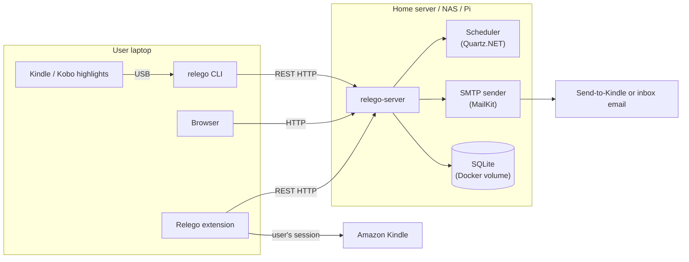

# Architecture — Relego

**Version:** 0.2 — Draft
**Date:** 2026-06-02
**Status:** Draft

---

## System Overview

Relego follows a client/server architecture. The server is the only always-on component; it hosts the React web UI and REST API together, while the CLI remains an optional client. A browser extension, also optional, collects Kindle cloud highlights inside the user's own Amazon session and pushes them to the server.



---

## Components

### Client CLI (`relego`)

- Distributed as a self-contained binary (macOS/Linux/Windows) or runnable via Docker
- Optional Docker image for no-install usage: `ghcr.io/krusty93/relego.cli`
- Reads the server URL from client configuration (`Server:Url`) with runtime override via `SERVER_URL` (no authentication — local network trusted)
- Responsibilities:
  - Parse and sync highlights from registered highlight sources to the server (Kindle and Kobo today)
  - Manage user settings via CLI commands (schedule, count, weights, exclusions)
  - Display server status

#### Highlight source registry (`Relego.Core/Sources/`)

The CLI imports through an open source registry rather than a closed source-type enum. Each source implements `IHighlightSource`, owns a stable `SourceDescriptor` (`Id`, `DisplayName`), implements its own `Locate(string? userPath)` detection rules, and returns the existing `ParseResult` from `ReadAsync`. The `HighlightSourceResolver` receives `IEnumerable<IHighlightSource>` from DI, calls each source's `Locate`, and returns every detected source without per-source branching.

The registry, the parsers (`Relego.Core/Parsing/`) and the device detectors live in `Relego.Core` so both front-end paths can use them: the CLI detects a mounted device and reads it locally, while the server parses the same formats from an uploaded file (`POST /imports`). Registering a new source therefore adds it to both surfaces at once.

Current sources:

- `KindleClippingsSource`: reads Kindle `.txt` clippings exports. Explicit file paths are accepted by `.txt` extension; auto-detection uses the existing Kindle detector to probe for `My Clippings.txt` on mounted devices.
- `KoboReaderSource`: detects and reads `.kobo/KoboReader.sqlite`. It copies the SQLite database to a temp file, validates the SQLite header, opens the copy read-only, and deletes the copy afterward so the mounted device database is never modified.

Adding a future integration is intentionally small: implement `IHighlightSource` and register one `AddSingleton<IHighlightSource, NewSource>()` line in `Program.cs`. Do not add a central enum, and do not edit the resolver, import workflow, or command surface for source-specific branching. `SourceDescriptor` is a reporting/logging label only.

When more than one source is detected, the import workflow imports all of them in one run. Each source is read and synced independently; a failure in one source is reported in the per-source summary and does not stop the remaining detected sources from importing. This behavior follows ADR-008 sections 3 and 5.

Kobo support is import-only. Kobo has no Send-to-Kindle-style email address, so no new server, schema, sync API, scheduler, recap composition, or device-delivery channel was added. Kobo users receive recaps through the existing regular inbox email channel (`delivery_email`, ADR-007 / feature 009).

All sources are responsible for transforming raw source data into structured data before syncing to the server.

- **Entry point**: `ClippingsParser.ParseAsync(string filePath, ILogger? logger = null)` — file-path overload; `ClippingsParser.ParseAsync(TextReader, ILogger? logger = null)` — streaming overload for testability
- **Output types**:
  - `ParseResult` — top-level result: list of `ParsedBook`, total entries processed, duplicates removed
  - `ParsedBook` — `(Title, Author?, IReadOnlyList<ParsedHighlight> Highlights)`
  - `ParsedHighlight` — `(Text, Location?, AddedOn?)`
- **Design decisions**:
  - Streaming for Kindle text: reads lines one-by-one via `ReadLineAsync()`; no full file in memory
  - Skip-and-warn: malformed entries are skipped with an `ILogger.LogWarning`; never throws
  - Deduplication: `HashSet<(Title, Author, Text)>` — exact case-sensitive match, first occurrence kept
  - Notes as highlights: entries of type "Note" are emitted as highlights with `[my note] ` prefix on their text
  - Bookmarks: entries of type "Bookmark" are silently dropped
  - Shared aggregation: `HighlightAggregator` performs deduplication and grouping for every source so Kindle and Kobo produce identical downstream shapes

#### TUI subsystem

> **Removed:** The TUI has been removed. Use the [web UI](http://localhost:8081) instead.

### Server (`relego-server`)

- Distributed as a Docker container
- Published to GHCR as `ghcr.io/krusty93/relego.server`
- Always-on, handles all automated operations
- Responsibilities:
  - Store highlights, recap history, weights, exclusions, settings in SQLite
  - Run scheduled recap generation (daily or weekly, configurable time)
  - Select highlights via spaced repetition algorithm
  - Compose recap document and send via SMTP to Kindle email address
  - Serve the React web UI and REST HTTP API from one origin
  - Accept cloud sync pushes from the browser extension and record highlight provenance

#### REST API layer (`Relego.Server/`)

The server currently exposes the MVP storage API as ASP.NET Minimal APIs.

- Composition root: `Program.cs`
- Endpoint modules: `Endpoints/`
- Data access: `Data/`
- Shared request/response contracts: `Relego.Core/Contracts/`
- OpenAPI: Swagger UI is enabled only in Development

The application registers a scoped `IDbConnection` backed by `Microsoft.Data.Sqlite`, opens the connection per request, enables SQLite foreign keys via `PRAGMA foreign_keys = ON`, and resolves thin repository classes over that connection.

Endpoint groups currently implemented:

- Sync: bulk import via `POST /highlights/import`
- Cloud sync: provider catalog, pairing, region and schedule, heartbeat, commands, jobs and batch ingest under `/sync/*` (see below)
- Import: multipart upload via `POST /imports` — accepts `My Clippings.txt` or `KoboReader.sqlite`, sniffs the format, parses with `Relego.Core`, and returns a per-book summary of added and duplicate highlights
- Settings: `GET /settings`, `PATCH /settings`, `POST /settings/test-kindle-email`, `POST /settings/test-recap-email`
- SMTP settings: `GET /settings/smtp`, `PUT /settings/smtp`, `POST /settings/smtp/test`
- Status: `GET /status`
- Recap: `POST /recaps`, `GET /recaps` (delivery history)
- Highlights: `GET /highlights`, `DELETE /highlights/{id}`
- Books: `GET /books`, `PUT /books/{id}/title`
- Exclusions: `*/{id}/exclusions` plus `GET /exclusions`
- Weights: `PUT /highlights/{id}/weight`, `GET /highlights/weights`

#### Cloud sync (`Relego.Server/Sync/`)

A second acquisition path alongside the import registry: instead of reading a file, the server
receives highlights a browser extension collected inside the user's own Amazon session.

The provider registry mirrors the highlight source registry. Each provider implements
`ICloudSyncProvider`, owns a stable `SourceDescriptor`, declares its `CloudSyncCapabilities`,
coverage disclosure, prerequisites, region profile, region disclosure and frequency policy, and
normalizes a pushed payload into the shared `SyncRequest` that feeds `SyncRepository.ImportAsync`
unchanged — so deduplication is the same code path as the CLI import. `KindleCloudProvider` is the
only registered implementation (`AddSingleton<ICloudSyncProvider, KindleCloudProvider>()`); endpoints
receive `IEnumerable<ICloudSyncProvider>` and route by `providerId`, so a new provider is one
registration line and never a branch in the endpoints or the database. `Descriptor.Id` is a routing
key only and is never branched on.

**The extension owns routine sync timing.** A browser alarm whose period is the user-chosen
frequency drives every routine sync; a fixed 60-second heartbeat alarm reports liveness and picks up
user-requested commands. The server never schedules a routine sync: it stores the desired interval on
`sync_connections.sync_interval_minutes` and hands it back, and the extension reconciles its own
alarm against the interval the server reports. `GET /status.kindleCloud` derives the cloud state from
stored columns rather than from scheduler state.

**Region allowlist.** `ParseProfile` carries the validated regions. There is no free-text host
anywhere: the extension offers the eight validated regions as a fixed list, and the server validates
the chosen region against the provider's profile. `RegionDisclosure` states that only the allowlisted
hosts are supported and is shown verbatim wherever the region list appears.

**Quartz is limited to the 45-day inactivity reminder.** `SchedulerService.ScheduleReminderAsync` is
registered on every boot, because the sweep is not user-scheduled and an existing recap trigger must
not stop it from being added to a database that predates it. `SyncReminderService` sweeps active
connections, raises one reminder per quiet period once a connection has reached its provider's
`InactivityReminderDays`, and delivers it in the app always and by email only when SMTP and a
delivery address are configured. The reminder is a nudge, never a sync: nothing in the sweep talks to
Amazon or to the extension, and a mail failure leaves the in-app reminder in place.

**Pairing.** `SyncTokenService` issues a one-time pairing code; only its hash is stored
(`sync_connections.token_hash`). The extension exchanges the code for a token and sends it as a
bearer credential. Amazon cookies, Amazon passwords, Amazon session tokens and the raw pairing token
are never stored, logged or returned; `RedactingTextFormatter` scrubs them from the log stream, and
`/sync/{providerId}` and `/sync/{providerId}/jobs` never carry page HTML.

#### SMTP configuration precedence

SMTP settings live in the `smtp_settings` table so they can be changed from the web UI without restarting the container. On first boot, when the table is empty, the `SMTP_*` environment variables seed it. From then on the database is authoritative and the environment variables are ignored; `SmtpConfigurationService` is the single read path used by `MailDeliveryService`. The password is never returned by `GET /settings/smtp`, and omitting it from `PUT /settings/smtp` keeps the stored value.

### Web UI (`src/relego.web/`)

Single-page application built with Vite and referenced by `Relego.Server` through `relego.web.esproj`. During `dotnet publish`, its production build is added to the server's `wwwroot` output as static web assets. ASP.NET Core serves those assets and the SPA fallback from the same origin as the API, so no browser CORS policy or runtime API URL configuration is needed.

- **Tech stack**: Vite 7, React 19, TypeScript, React Router, TanStack Query. Plain CSS with a token layer.
- **Same-origin API calls**: browser requests use relative paths, so the web UI always talks to the server that served it.
- **Offline-capable assets**: fonts are bundled (`@fontsource/playfair-display`); nothing is fetched from a CDN at runtime, which matters for a self-hosted tool on an isolated network.
- **Routes**: `/` library · `/books/{id}` one book's highlights · `/highlights` all highlights · `/recaps` · `/import` · `/settings`
- **Accessibility**: every route is verified with axe-core in both themes at desktop and mobile widths, plus the command palette, shortcut sheet, expanded highlight, and rename dialog. The suite fails on any violation.
- **Build**: `dotnet publish src/Relego.Server` restores the locked npm dependencies, runs the Vite production build, and writes the assets to the server publish output's `wwwroot/`. `cd src/relego.web && npm run build` remains available for frontend-only work.
- **Tests**: `cd src/relego.web && npm test` — Playwright builds the SPA, starts `relego-server` against a throwaway SQLite file, seeds the fixtures used by the .NET tests, then runs the behavioural and accessibility suites.
- **Integration**: `relego.web.esproj` is included in `Relego.slnx` and referenced by the server to define one publishable server-and-web artifact. The React source, dependencies, and frontend test tooling remain independent from the .NET implementation.

---

### Browser extension (`src/relego.extension/`)

MV3 extension that performs cloud sync on the user's behalf inside their own Amazon session. It is
not part of the .NET solution and is versioned and released independently (`extension/v<version>`,
see [VERSIONING.md](../VERSIONING.md)).

- **Tech stack**: TypeScript, Vite (library build), Vitest. `jszip` for packaging only.
- **Scope**: it is the only component that talks to Amazon. The server never holds Amazon
  credentials, so the extension reads the signed-in session itself and pushes normalized highlights
  to `POST /sync/{providerId}/jobs/{jobId}/batches`.
- **Cadence**: the extension owns routine sync timing with a browser alarm at the frequency the user
  chose in the web UI, plus a fixed 60-second heartbeat alarm for liveness and user-requested
  commands. The server stores the desired interval and returns it; it never schedules a routine sync.
- **Permissions**: `manifest.json` grants **no host at install**. The user grants the Amazon hosts
  explicitly through `optional_host_permissions`, and only allowlisted hosts are ever requested.
- **Regions**: the eight validated Amazon regions are offered as a fixed list; there is no free-text
  host input, and the server re-validates the selection.
- **Distribution**: two builds from one source. Chrome/Edge ship the MV3 module service worker;
  Firefox does not support `background.service_worker`, so its variant uses a classic event page
  (`background.scripts`), requires Firefox 128+ for `optional_host_permissions`, and carries the
  `browser_specific_settings.gecko.id` needed for AMO signing.
- **Build and package**: `cd src/relego.extension && npm ci && npm run package` produces
  `release/relego-extension-<version>-chrome.zip` and `-firefox.zip`, with the version stamped from
  `RelegoExtensionVersion` in `src/PackageVersions.props`. CI uploads both packages as artifacts;
  the release workflow attaches them to the `extension/v<version>` release with cosign signatures
  and SHA256 checksums. The generated archives are never committed.
- **Tests**: `cd src/relego.extension && npm test` — unit tests plus a packaging suite that builds
  both variants and asserts on the real archives (version stamping, no host granted at install,
  Chrome module service worker, Firefox classic event page and AMO identity).

---

### Landing Page (`src/landing/`)

Static marketing landing page built with Astro and Tailwind CSS. Completely independent from the .NET solution: separate `package.json`, separate build, separate test suite.

- **Tech stack**: Astro 6, Tailwind CSS v4 (via PostCSS), Playwright for E2E testing
- **Deployment target**: GitHub Pages (static HTML output, no server required)
- **Build**: `cd src/landing && npm run build` → outputs to `src/landing/dist/`
- **Tests**: `cd src/landing && npx playwright test` — Chromium-only, includes axe-core accessibility audit
- **Separation**: no shared code, no shared dependencies with the .NET projects; the landing page can be deployed and developed independently

---

## Technology Stack

| Component                | Technology                                 | Rationale                                                 |
|--------------------------|---------------------------------------------|-----------------------------------------------------------|
| Language / runtime       | .NET 10 (C#)                   | Cross-platform, self-contained binaries, rich ecosystem |
| Client distribution      | Single-file binary / Docker    | Zero runtime dependency for end users                   |
| Server distribution      | Docker container | One server-and-web artifact for self-hosted deployment |
| Storage                  | SQLite (file in Docker volume) | Zero config, single file, no extra container            |
| Client/server protocol   | REST HTTP                      | Simple, debuggable, universally supported               |
| Email delivery           | MailKit + SMTP                 | Industry standard, supports Send-to-Kindle              |
| Logging                  | Serilog (file + SQLite sink)   | Structured logging, persistent, queryable               |
| Scheduling               | Quartz.NET                     | Mature .NET scheduler, cron-style expressions           |
| CLI UX                   | Spectre.Console                | Rich terminal output, tables, progress bars             |
| Web UI                   | Vite + React + plain CSS       | Static build published with the server, same-origin API |
| Browser extension        | TypeScript + Vite (MV3)        | Cloud sync inside the user's own Amazon session |
| Landing page             | Astro + Tailwind CSS           | Static site generation, minimal JS, fast build          |

---

## Data Model

```
users            (id, kindle_email[''], delivery_email[NULL], created_at)
authors          (id, name)
books            (id, user_id, author_id, title)
highlights       (id, user_id, book_id, text, weight[1-5], excluded, last_seen, delivery_count, created_at)
excluded_books   (id, user_id, book_id, excluded_at)
excluded_authors (id, user_id, author_id, excluded_at)
settings         (user_id, schedule['daily'|'weekly'], delivery_day, delivery_time[default:'18:00'], count[1-15, default:3])
sync_connections (id, user_id, provider_id, token_hash, state, disclosure_version, profile_version,
                  region_id, region_changed_at, sync_interval_minutes, schedule_updated_at,
                  applied_interval_minutes, next_sync_due_at, pending_command, connected_at,
                  last_heartbeat_at, last_sync_started_at, last_sync_completed_at,
                  last_new_content_at, last_auth_expired_at, created_at)
sync_jobs        (id, connection_id, user_id, idempotency_key, mode, trigger, status, phase,
                  books_total, books_done, highlights_seen, highlights_new,
                  highlights_duplicate, truncated_books, failure_code, failure_detail,
                  recovery_steps, started_at, ended_at)
sync_job_batches (job_id, batch_index, new_highlights, duplicate_highlights, new_books,
                  new_authors, received_at)
highlight_provenance (highlight_id, connection_id, source_id, region_id, external_id, truncated,
                  location, note, color, first_seen_at, last_seen_at)
sync_reminders   (id, connection_id, user_id, quiet_since, threshold_days, created_at, emailed_at,
                  dismissed_at, resolved_at)
```

> **Cloud sync credentials:** `sync_connections.token_hash` stores a hash of the pairing token only. Amazon cookies, Amazon passwords and Amazon session tokens are never persisted — the extension holds the Amazon session and the server stores highlights plus provenance.

> **Delivery destinations:** both `kindle_email` and `delivery_email` are optional; at least one must be set for recap delivery. `POST /recaps` returns HTTP 422 when neither is configured.

> **MVP note:** Single-user only. The server auto-creates or reuses user `id = 1` on demand for every API request.

Current uniqueness constraints used by the REST layer:

- `authors(name)`
- `books(user_id, author_id, title)`
- `highlights(user_id, book_id, text)`

---

## Core Query — Recap Selection

```sql
SELECT h.*
FROM highlights h
WHERE h.user_id = @userId
  AND h.excluded = 0
  AND h.book_id NOT IN (SELECT book_id FROM excluded_books WHERE user_id = @userId)
  AND h.author_id NOT IN (SELECT author_id FROM excluded_authors WHERE user_id = @userId)
ORDER BY (h.weight * RANDOM()) DESC, h.last_seen ASC
LIMIT @count
```

---

## REST API Surface

| Method   | Path                              | Description                                 | Tag        |
|----------|-----------------------------------|---------------------------------------------|------------|
| `POST`   | `/highlights/import`              | Bulk import highlights from client          | Sync       |
| `GET`    | `/sync/providers`                 | Cloud sync provider catalog with capabilities and disclosures | Sync     |
| `GET`    | `/sync/{providerId}`              | Connection state, region, schedule, reminders, latest job | Sync     |
| `POST`   | `/sync/{providerId}/connection`   | Create the connection and disclose coverage | Sync     |
| `DELETE` | `/sync/{providerId}/connection`   | Disconnect and revoke the extension token   | Sync     |
| `POST`   | `/sync/{providerId}/pair`         | Exchange a one-time pairing code for a token | Sync     |
| `GET`    | `/sync/{providerId}/regions`      | Validated region allowlist and disclosure   | Sync     |
| `PUT`    | `/sync/{providerId}/region`       | Set the Amazon region                       | Sync     |
| `PUT`    | `/sync/{providerId}/schedule`     | Set the desired sync frequency              | Sync     |
| `POST`   | `/sync/{providerId}/reminders/{id}/dismiss` | Dismiss an inactivity reminder     | Sync     |
| `POST`   | `/sync/{providerId}/heartbeat`    | Extension liveness and pending command poll | Sync     |
| `POST`   | `/sync/{providerId}/commands`     | Queue a user-requested sync command         | Sync     |
| `GET`    | `/sync/{providerId}/jobs`         | Job history for the connection              | Sync     |
| `POST`   | `/sync/{providerId}/jobs`         | Open a sync job                             | Sync     |
| `POST`   | `/sync/{providerId}/jobs/{jobId}/batches` | Push a normalized highlight batch   | Sync     |
| `POST`   | `/sync/{providerId}/jobs/{jobId}/progress` | Report book/highlight progress      | Sync     |
| `POST`   | `/sync/{providerId}/jobs/{jobId}/complete` | Complete a sync job                 | Sync     |
| `POST`   | `/sync/{providerId}/jobs/{jobId}/fail`     | Fail a sync job with recovery steps | Sync     |
| `POST`   | `/imports`                        | Upload and parse a clippings or Kobo file   | Import     |
| `GET`    | `/status`                         | Server status, next recap, highlight stats  | Status     |
| `GET`    | `/settings`                       | Read current settings                       | Settings   |
| `PATCH`  | `/settings`                       | Partially update settings                   | Settings   |
| `POST`   | `/settings/test-kindle-email`     | Send a test email via Send-to-Kindle        | Settings   |
| `POST`   | `/settings/test-recap-email`      | Send a test HTML email to the inbox address | Settings   |
| `GET`    | `/settings/smtp`                  | Read SMTP settings (password never returned) | Settings  |
| `PUT`    | `/settings/smtp`                  | Update SMTP settings                        | Settings   |
| `POST`   | `/settings/smtp/test`             | Verify the SMTP connection                  | Settings   |
| `POST`   | `/recaps`                         | Execute a recap immediately                 | Recap      |
| `GET`    | `/recaps`                         | Recap delivery history                      | Recap      |
| `GET`    | `/highlights`                     | List/paginate/search highlights             | Highlights |
| `DELETE` | `/highlights/{id}`                | Delete a highlight                          | Highlights |
| `PUT`    | `/highlights/{id}/weight`         | Set highlight recap weight                  | Weights    |
| `GET`    | `/highlights/weights`             | List weighted highlights                    | Weights    |
| `GET`    | `/books`                          | List books with highlight counts            | Books      |
| `PUT`    | `/books/{id}/title`               | Rename a book                               | Books      |
| `POST`   | `/highlights/{id}/exclusions`     | Exclude a highlight                         | Exclusions |
| `DELETE` | `/highlights/{id}/exclusions`     | Re-include a highlight                      | Exclusions |
| `POST`   | `/books/{id}/exclusions`          | Exclude a book                              | Exclusions |
| `DELETE` | `/books/{id}/exclusions`          | Re-include a book                           | Exclusions |
| `POST`   | `/authors/{id}/exclusions`        | Exclude an author                           | Exclusions |
| `DELETE` | `/authors/{id}/exclusions`        | Re-include an author                        | Exclusions |
| `GET`    | `/exclusions`                     | List all exclusions                         | Exclusions |

### Data access pattern

The REST layer uses Dapper with explicit SQL rather than EF Core.

- Each repository encapsulates one domain slice and receives `IDbConnection` via DI
- Queries stay close to the endpoint behavior they support
- Sync import uses a database transaction to keep author, book, and highlight insertion consistent
- Cloud sync batches are idempotent per `batchIndex`: a replayed batch returns the stored counts unchanged, and highlights are only ever inserted, never updated or deleted
- Read models returned by list endpoints are projected directly into DTOs rather than materializing richer domain aggregates

Current repository split:

- `UserRepository`: implicit MVP user bootstrap and user email persistence
- `SyncRepository`: bulk import and deduplication
- `SettingsRepository`: settings read/upsert
- `StatusRepository`: aggregate counters
- `ExclusionRepository`: inclusion/exclusion mutations and exclusion listings
- `WeightRepository`: weight updates and weighted highlight listings
- `SyncConnectionRepository`, `SyncJobRepository`, `SyncReminderRepository`: cloud sync connection state, job lifecycle and inactivity reminders
- `ProvenanceRepository`: per-highlight origin (source, region, external id, truncation)

### Error handling

The API returns JSON-only responses.

- Validation failures use `Results.ValidationProblem(...)` and return HTTP `422`
- Missing entities use `Results.Problem(...)` and return HTTP `404`
- Successful mutations that do not need a body return HTTP `204`
- Successful reads return HTTP `200` with DTO payloads from `Relego.Core/Contracts/`

Cloud sync failures are modelled as data, not as HTTP errors: a job that fails records a
`failure_code`, a human-readable `failure_detail` and ordered `recovery_steps`, and the extension
shows them verbatim. Only malformed or unauthorized requests (unknown provider, missing or revoked
token, region outside the allowlist, a batch larger than the accepted size) fail the HTTP call.

This keeps the client protocol small, explicit, and aligned with the quickstart `curl` flows.

### Contract naming conventions

Transport objects in `Relego.Core/Contracts/` follow these suffixes:

| Suffix      | Usage                                                                                                          |
|-------------|------------------------------------------------------------------------------------------------------------------|
| `*Request`  | Inbound root-level request bodies (e.g. `SyncRequest`, `UpdateSettingsRequest`)                                |
| `*Response` | Outbound root-level response bodies (e.g. `StatusResponse`, `HighlightsResponse`)                              |
| `*Dto`      | Nested data-transfer objects used as list items or sub-objects within a response (e.g. `WeightedHighlightDto`) |

## Project structure

```tree
src/Relego.Core/
├── Branding/           # Shared wordmark and palette constants
├── Contracts/          # Shared request/response DTOs for CLI, server and web UI
├── Parsing/            # My Clippings.txt parser and shared highlight aggregation
└── Sources/            # Highlight source registry, source readers, resolver, device detectors

src/Relego.Cli/
├── Commands/           # Spectre.Console CLI sub-commands (sync, status, config, …)
├── Import/             # Device import workflow
├── Infrastructure/     # HTTP client and resilience
└── Program.cs          # CLI entry point

src/Relego.Server/
├── Data/               # Dapper repositories over SQLite
├── Endpoints/          # Minimal API endpoint modules
├── Infrastructure/     # Database bootstrap, logging and redaction
├── Jobs/               # Quartz jobs (recap delivery, inactivity reminder)
├── Models/             # Server-side domain models
├── Services/           # Upload import, SMTP configuration, mail delivery, scheduling
├── Sync/               # Cloud sync provider registry, orchestration and failure recovery
└── Program.cs          # Composition root and DI wiring

src/Relego.Tests/
├── Api/                # End-to-end HTTP integration tests via WebApplicationFactory, including the cloud sync API surface
├── Cli/                # CLI command tests
├── Infrastructure/     # Database/bootstrap tests
├── Parsing/            # Parser tests
├── Recap/              # Recap service tests
├── Services/           # Recap, cloud sync provider, region and reminder-job tests
└── Sources/            # Highlight source, resolver, and multi-import tests

src/relego.extension/       # MV3 browser extension performing cloud sync (independent from .NET)
├── src/                # Background service worker, content scripts, API client
├── scripts/            # Chrome and Firefox packaging
├── tests/              # Unit tests plus packaging assertions on the real archives
├── manifest.json       # Base MV3 manifest; no host granted at install
└── vite.config.*.ts    # Chrome (module service worker) and Firefox (classic event page) builds

src/relego.web/             # React/Vite SPA published with Relego.Server
├── relego.web.esproj # JavaScript SDK project referenced by the server
├── src/components/     # App shell, command palette, shortcuts sheet, primitives
├── src/routes/         # Library, Highlights, Import, Recaps, Settings
├── src/lib/            # API client, theme, hotkeys, toasts, formatting
├── src/styles/         # Design tokens and global stylesheet
└── tests/              # Playwright behavioural and axe-core accessibility suites

src/landing/                # Static marketing landing page (independent from .NET)
├── pages/              # Astro pages (index.astro)
├── components/         # Reusable Astro components (Navbar, Footer, Section, etc.)
├── config/             # Site configuration (site.ts)
├── layouts/            # Layout wrapper
├── styles/             # Global CSS with Tailwind + CSS variables
├── assets/             # Images (hero)
└── tests/              # Playwright E2E tests (navigation, theme, content, a11y)
```

---

## ADR Index

| ADR                                                     | Decision                                     |
|---------------------------------------------------------|----------------------------------------------|
| [ADR-001](adr/001-client-server-architecture.md)        | Client/server architecture                   |
| [ADR-002](adr/002-dotnet-core-runtime.md)               | .NET Core as language/runtime                |
| [ADR-003](adr/003-sqlite-storage.md)                    | SQLite as storage engine                     |
| [ADR-004](adr/004-rest-http-protocol.md)                | REST HTTP as client/server protocol          |
| [ADR-005](adr/005-my-clippings-txt-highlight-source.md) | `My Clippings.txt` as MVP highlight source   |
| [ADR-006](adr/006-docker-only-distribution.md)          | Docker-only server distribution              |
| [ADR-007](adr/007-dual-channel-email-delivery.md)       | Dual-channel email delivery                  |
| [ADR-008](adr/008-kobo-reader-sqlite-source.md)         | `KoboReader.sqlite` as Kobo highlight source |
