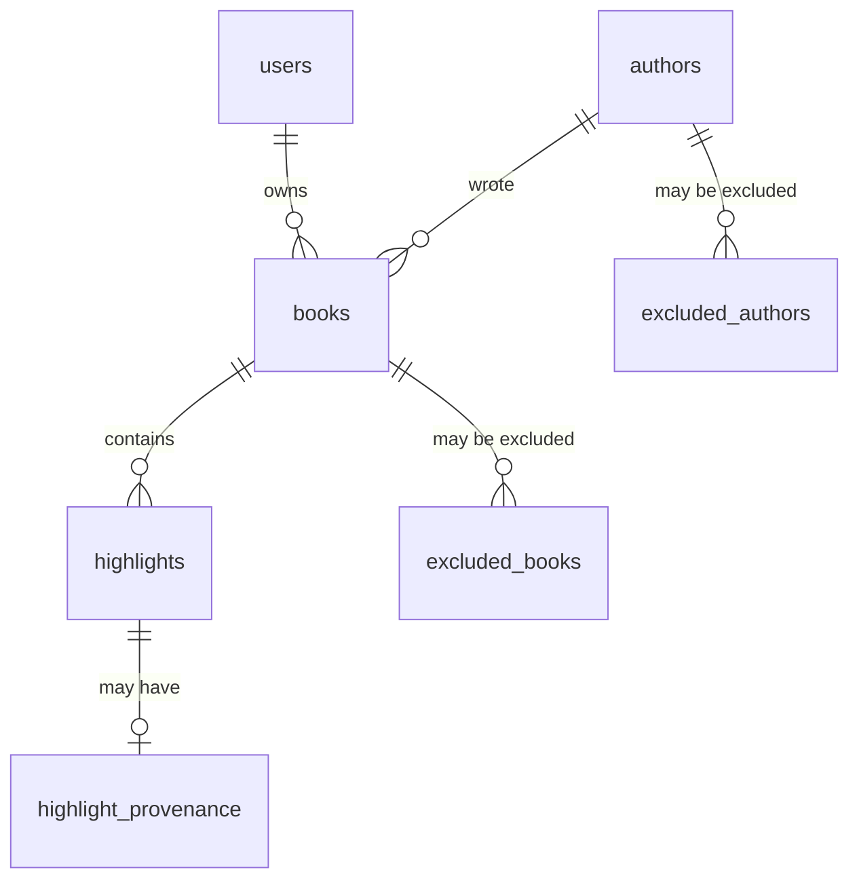

# Data Model: Reading Annotations, Notes, and Chapters

**Feature**: 012-reading-annotations | **Spec**: [spec.md](spec.md) | **Decisions**: [research.md](research.md)

Two things live in this document: the **stored** model (SQLite, `/data/relego.db`) and the
**derived** model (computed on read, never persisted). The split is the central design decision
(R3, R6): anything the reader can change on the device at any time — chapters, chapter paths,
stitched passages — is derived, so it can never go stale.



Chapters, chapter paths and stitched passages are **not** in this diagram because they are not
stored: they are projections over the rows of one `books` entry, recomputed on every read.

## Stored model

### `highlights` (extended)

Existing columns are unchanged. `text` stops carrying notes and stops carrying markers.

| Column | Type | Null | Notes |
|--------|------|------|-------|
| `id` | INTEGER PK AUTOINCREMENT | no | unchanged |
| `user_id` | INTEGER → `users(id)` | no | unchanged |
| `book_id` | INTEGER → `books(id)` | no | unchanged |
| `text` | TEXT | no | **the passage only.** `''` for a note-only annotation. Never contains `.hN`, `.cN`, `.tag` tokens or the legacy `[my note] ` prefix (FR-005, FR-010) |
| `weight` | INTEGER 1–5 default 3 | no | unchanged, never touched by this feature |
| `excluded` | INTEGER default 0 | no | unchanged |
| `last_seen` | TEXT | yes | unchanged; used by recaps to age a highlight |
| `delivery_count` | INTEGER default 0 | no | unchanged |
| `created_at` | TEXT (ISO-8601) | no | **when Relego learned about the row** (FR-007). For existing rows: preserved as-is. For new rows: import time |
| `note` | TEXT | yes | **new.** the reader's commentary after every reserved token was removed; `NULL` = no note (FR-011, FR-017). `''` is never stored — normalised to `NULL` |
| `heading_level` | INTEGER 1–3 | yes | **new.** set when the note carried `.h1`–`.h3`; `NULL` = not a chapter (FR-018) |
| `stitch_level` | INTEGER ≥ 1 | yes | **new.** set when the note carried `.cN`; `NULL` = not part of a stitched passage (FR-041) |
| `tags` | TEXT | yes | **new.** space-separated tags in the reader's spelling, e.g. `prob review`; `NULL` = no tags (FR-046, FR-051) |
| `source_position` | TEXT | yes | **new.** the raw position exactly as the source reported it, e.g. `Location 1234-1236`; `NULL` = unknown (FR-006) |
| `position_start` | INTEGER | yes | **new.** leading integer parsed from `source_position`, used for ordering; `NULL` when unparseable (R7) |
| `position_kind` | TEXT | yes | **new.** `'location'` or `'page'`; `NULL` = unknown. Two kinds in one book disable position ordering (R3) |
| `added_on` | TEXT (ISO-8601) | yes | **new.** the date the source reported; `NULL` = unknown, never filled from `created_at` (FR-007, FR-009) |

**Constraints**

- `CHECK (heading_level IS NULL OR heading_level BETWEEN 1 AND 3)`
- `CHECK (stitch_level IS NULL OR stitch_level >= 1)`
- `CHECK (position_kind IS NULL OR position_kind IN ('location', 'page'))`
- `CHECK (length(text) > 0 OR note IS NOT NULL)` — a row must carry a passage or a note, never
  neither.

**Indexes**

```sql
CREATE UNIQUE INDEX uq_highlights_user_book_passage
    ON highlights(user_id, book_id, text, coalesce(source_position, ''))
    WHERE text <> '';

CREATE UNIQUE INDEX uq_highlights_user_book_note
    ON highlights(user_id, book_id, note)
    WHERE text = '';

CREATE INDEX idx_highlights_user_book_order
    ON highlights(user_id, book_id, position_start, added_on, id);
```

`uq_highlights_user_book_text` is dropped (R5). The first index is the annotation identity for
passages; the second is the identity for note-only annotations. The third serves source-order reads
for a whole book.

**Identity resolution on import** (one transaction, replacing `INSERT OR IGNORE`):

```text
parse markers -> (note, heading, stitch, tags)
select id from highlights
  where user_id = @u and book_id = @b and text = @text
    and coalesce(source_position, '') = coalesce(@pos, '')
if found:  UPDATE the row's note/heading/stitch/tags/provenance where any value differs
           -> counted as an existing annotation (not new)
else:      INSERT the row with weight 3, excluded 0, delivery_count 0
           -> counted as new
```

A re-import that adds, changes or removes a note, marker or tag therefore updates in place and
preserves `weight`, `excluded`, `delivery_count`, `last_seen` and `id` (FR-034, FR-036, Story 1 AS-4,
Story 1 AS-5). A re-import with identical values is a no-op. Nothing is ever deleted by an import.

### `authors` (relaxed)

| Column | Change |
|--------|--------|
| `name` | `TEXT NOT NULL` → `TEXT NULL`. `NULL` means the source reported no author and is presented as unknown (FR-008). Existing rows holding the literal `"Unknown Author"` become `NULL` (R8). |

Indexes: `uq_authors_name ON authors(name)` (NULLs are distinct in SQLite) plus
`uq_authors_unknown ON authors(name) WHERE name IS NULL` to guarantee exactly one unknown-author row,
so the import resolves it with a single `SELECT` and never accumulates duplicates. `books.author_id`
stays `NOT NULL` and points at that single row.

### `schema_migrations` (new)

| Column | Type | Null | Notes |
|--------|------|------|-------|
| `id` | TEXT PK | no | e.g. `012-note-split-and-identity` |
| `applied_at` | TEXT (ISO-8601) | no | when the migration committed |

One row means "done". The migration is applied inside a transaction that also inserts the row, so a
crash either does everything or nothing (Story 4 AS-3).

### Untouched

`users`, `books`, `excluded_books`, `excluded_authors`, `settings`, `recap_jobs`, `smtp_settings`,
`sync_*`, `highlight_provenance`. The only interaction is that `highlight_provenance` rows keep
pointing at the same `highlight_id` across the migration, because the migration never reinserts
highlights (FR-054).

## Derived model (never persisted)

### `AnnotationContext`

Computed per book by `AnnotationContextService` and attached to every annotation returned to a
consumer.

| Field | Type | Rule |
|-------|------|------|
| `ChapterId` | `int?` | `id` of the annotation whose passage titles the chapter; `null` = unknown chapter (FR-022, FR-025) |
| `ChapterPath` | `string[]` | ancestor titles, root first, ending with the current chapter's title; empty for the unknown chapter (FR-027) |
| `StitchGroupId` | `int?` | `id` of the group's first fragment; `null` when not stitched (FR-043) |
| `StitchIndex` | `int?` | 0-based position in the group |
| `StitchedText` | `string?` | the joined passage; set on the group's first fragment only, so a paginated list shows the joined form once (FR-045) |

### `Chapter`

| Field | Rule |
|-------|------|
| `Id` | the titling annotation's `id` |
| `Title` | that annotation's `text` (a heading marker on a passage with no text creates no chapter) |
| `Note` | that annotation's `note` — the section summary (FR-017) |
| `Level` | 1–3 from `heading_level` |
| `ParentId` | nearest preceding chapter with a strictly smaller level, else `null` |
| `Position` / `AddedOn` | the titling annotation's provenance, unknown as `null` |
| `AnnotationCount` | annotations whose `ChapterId` is this chapter, plus its descendants' |

Two chapters with the same title stay distinct because identity is the annotation `id`, never the
title.

### `TableOfContents`

| Field | Rule |
|-------|------|
| `HasTableOfContents` | `true` iff the book has at least one `heading_level = 1` annotation (FR-026). Otherwise the web UI and CLI offer no chapter navigation at all |
| `Chapters` | level-ordered list as above |
| `UnknownChapter` | always present; `Id = null`, `Title` is a localised "Unknown chapter", holds every annotation before the first heading |

### `StitchedPassage`

| Field | Rule |
|-------|------|
| `Id` | `id` of the `.c1` fragment |
| `FragmentIds` | member `id`s in source order |
| `Text` | member `text`s joined with `" … "`; a single member has no trailing ellipsis (R6) |
| `Note` | the `.c1` fragment's note (each fragment keeps its own too) |
| `Tags` | union of the members' tags, reader spelling, de-duplicated |

Rules from the spec that live in the builder:

- a `.cN` with `N ≥ 2` and no open group is not stitched and its marker surfaces as a tag (Story 6
  AS-2);
- an excluded fragment is omitted from `Text` while the remaining fragments still stitch (FR-044);
- two fragments with identical text at different positions are both members (R5);
- a fragment's own note, position, weight, exclusion and delivery history are never modified
  (FR-043).

### Source order

Both builders share one ordering function:

```text
if every positioned annotation in the book reports the same position_kind
    and every annotation has a position_start:
        order by position_start asc, id asc
else:
        order by added_on asc (NULLs last), id asc
```

This is what makes "a later sync supplies earlier pages" and "page versus location in one book"
resolve to the reader's reading order rather than to arrival order (FR-037, edge cases).

## Validation rules

| Rule | Where enforced | Requirement |
|------|----------------|-------------|
| A note that is only whitespace is stored as `NULL` and never shown | marker parser | FR-011 |
| `.h0`, `.h4`, `.hx` are not heading markers | marker parser | FR-018 |
| A bare `.` is commentary, not a tag | marker parser | FR-050 |
| The same tag twice in one note is applied once | marker parser | FR-051 |
| `.cN` without an open group surfaces as a tag, not as commentary | stitch builder | Story 6 AS-2 |
| Chapter needs non-empty passage text | chapter builder | Story 2 edge case |
| Table of contents needs ≥ 1 level-1 heading | chapter builder | FR-026 |
| A missing note/chapter/tag/position/date is `null`, never invented | import + DTO mapping | FR-009 |
| `chapterId`/`tag` filters that match nothing return an empty page with `total = 0`, not 404 | endpoints | FR-030 |
| Pagination is `page ≥ 1` and `1 ≤ pageSize ≤ 200`, else 422 | endpoints | existing contract |

## State transitions

An annotation's state changes only by import or by an explicit API call; nothing here is
time-driven.

```text
            +----- import (new identity) -----> [stored]
   (nothing)                                      |
                                                  | import, same identity, different content
                                                  v
                                             [updated in place]
                                                  |
              exclude / weight / delete (existing endpoints, unchanged)
                                                  v
                                    [excluded] [re-weighted] [deleted]

   chapter/stitch membership: RECOMPUTED on every read from the current rows.
   Removing a heading marker on the device and re-importing is a normal "updated in place":
   the annotation stays, its heading_level becomes NULL, and its followers fall back to the
   nearest remaining chapter or to the unknown chapter (edge cases).
```

## Upgrade path for existing data

```text
open db (PRAGMA foreign_keys = ON, set in Program.cs)
  -> SchemaBootstrap.SchemaSql: additive tables + columns (CREATE TABLE IF NOT EXISTS)
  -> EnsureColumnAsync x8  (new highlights columns; harmless on a fresh database)
  -> PRAGMA foreign_keys = OFF          (required for the authors rebuild)
  -> BEGIN
       if '012-note-split-and-identity' not in schema_migrations:
            rebuild authors with nullable name; sentinel rows -> NULL; recreate both indexes
            split '[my note] ' rows: note = remainder (marker-parsed), text = ''
            drop uq_highlights_user_book_text; create the three new indexes
            insert the schema_migrations row
       COMMIT
  -> PRAGMA foreign_keys = ON           (restored in a finally)
```

After the upgrade: same annotation count, same weights, same exclusions, same delivery counts, same
provenance rows, same books and authors — only notes moved out of `text`, the legacy sentinel became
`NULL`, and the identity indexes changed (SC-008).
